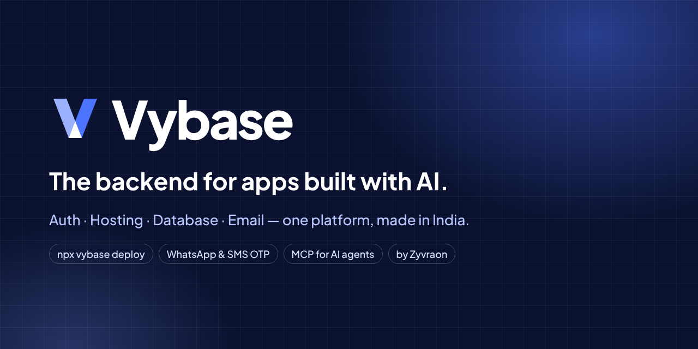

<p align="center"></p>

# vybase (Python)

Server-side SDK for Vybase Auth: verify your users' access tokens in your API, manage users with the
secret key, and call the auth endpoints.

```bash
pip install "vybase @ git+https://github.com/FZHAMZAALI/project-.git#subdirectory=packages/sdk-python"
```

```python
import os
from vybase import Vybase, VybaseError

zyv = Vybase("https://auth.zyvraone.site", secret_key=os.environ["VYBASE_SECRET_KEY"], project_id="prj_…")

# In a FastAPI / Flask route:
claims = zyv.verify_token(request.headers["authorization"].removeprefix("Bearer "))
print(claims.user_id, claims.email)

zyv.admin.list_users(q="gmail.com")
zyv.admin.ban_user(user_id)
```

Errors raise `VybaseError` with a stable `.code` (`invalid_token`, `email_taken`, `user_not_found`, …).
Tokens are verified offline against the cached JWKS (ES256); pass `project_id` so the audience is checked.

Tests: `VYBASE_TEST_URL=http://localhost:8787 VYBASE_TEST_ADMIN=dev pytest`.

---

**Vybase** is the backend for apps built with AI: auth, hosting, database and email in one platform.
Console: https://console.zyvraone.site · Docs for AI tools: https://auth.zyvraone.site/llms.txt · Built in India by [Zyvraon](https://api.zyvraone.site).

License: MIT
